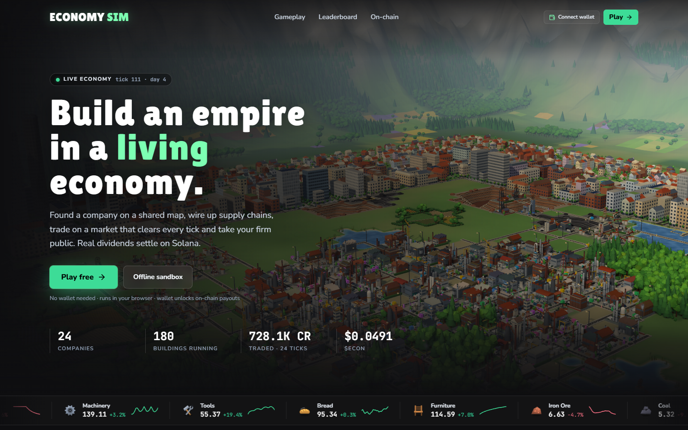
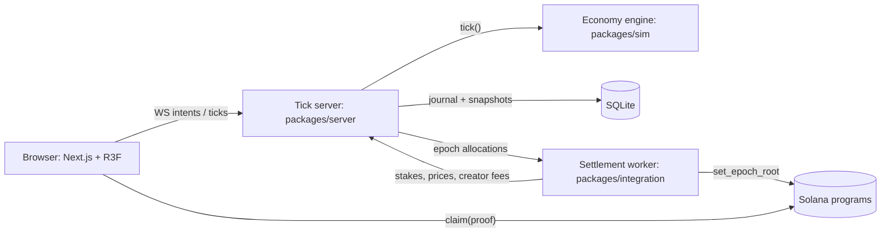

# On-chain Economy Sim

[](https://github.com/omarpatel/onchain-economy-sim/actions/workflows/ci.yml)
[](LICENSE)




<sub>Landing page running locally against the tick server (`npm run server` + `npm run web`).</sub>

A multiplayer economic strategy game whose simulation runs off-chain on one authoritative tick server, with value settled on Solana.

## Overview

Players start companies on a shared 32×32 map. They build production chains, trade goods on a clearing market, list companies on an internal share exchange, borrow from a bank, and stake tokens to boost production. A deterministic engine computes the whole economy each tick. The tick server is the only authority and saves its state to SQLite. A separate settlement worker turns each epoch's allocations into Merkle roots and publishes them to Anchor programs, where players claim their payouts. In-game balances never mint on-chain value. Payout pools are capped by real inflows that the worker observes on-chain, such as creator fees and staking positions.

## Features

- **Deterministic economy engine** with no dependencies. It has a double-entry ledger in integer minor units, 14 goods and recipes, a clearing market, an order-book share exchange with IPO bookbuilding, a bank, logistics, and NPC managers and investors. Its state serializes for byte-identical replay.
- **Intent-based protocol.** Player actions are applied atomically at the start of each tick, and each tick emits typed game events.
- **Authoritative tick server** using `node:sqlite` and `ws`. It supports Sign-In With Solana and guest auth, broadcasts each tick over WebSocket, writes a journal and then snapshots, and computes allocations per epoch.
- **3D browser client** built with Next.js 15, React 19 and React Three Fiber. It has an RTS-style camera, a procedural city and landscape, a market view, an exchange view with charts, and a Solana wallet adapter for claims. If no server is reachable, it falls back to an in-browser sandbox.
- **Settlement worker.** It builds Merkle proofs, publishes epoch roots with a hard per-epoch ceiling and a funder-balance check, serves proofs over HTTP, reads on-chain staking positions, and sends Pyth/Jupiter prices and creator-fee inflows to the server. It runs in dry-run mode by default.
- **Four Anchor 0.31 programs:** `dividends` (per-epoch Merkle distributor with receipts and an expiry sweep), `staking` (lock, boost and yield), `equity` (IPOs with an escrowed founder lockup) and `memecoin_factory` (bonding curve). They are tested with LiteSVM.

## Architecture



## Tech stack

- TypeScript running natively on Node.js, using npm workspaces
- Next.js 15, React 19, Three.js / React Three Fiber, Tailwind CSS, lightweight-charts
- `node:sqlite`, `ws`
- Solana web3.js, SPL Token, Solana wallet adapter
- Rust and Anchor 0.31 for the programs, with LiteSVM for tests

## Getting started

You need a Node.js version that ships `node:sqlite` and native TypeScript support (Node 24 is recommended). Building and testing the Anchor programs needs a Rust/Solana/Anchor toolchain. The package scripts run it through WSL (Ubuntu-24.04).

```bash
npm install

npm run server     # tick server on :8787 (override with PORT)
npm run web        # Next.js dev server on :3000, game at /play
npm run worker     # settlement worker (dry-run unless RPC_URL / KEYPAIR / ECON_MINT are set)
```

To configure the web client, copy `packages/web/.env.example` to `packages/web/.env.local` and set `NEXT_PUBLIC_ECON_SERVER` to the tick server's origin.

To run the simulation headless:

```bash
npm run sim
npm run sim:long   # 720 ticks, 12 players, 40 NPCs
```

Checks:

```bash
npm test
npm run typecheck
npm run build
npm run test:chain   # Anchor program tests (WSL)
```

`packages/integration/README.md` documents an end-to-end run on localnet: deploy, stake, close an epoch, publish the root, then claim. You need to generate program keypairs locally with `npm --workspace=@econ-sim/chain run keys` before deploying.

## Project structure

```
packages/
  sim/          deterministic economy engine and headless runner
  server/       authoritative tick server (HTTP + WebSocket + SQLite)
  web/          Next.js 3D client
  integration/  settlement worker, Merkle proofs, oracle and fee feeds
  chain/        Anchor programs and LiteSVM tests
```

## License

MIT. See [LICENSE](LICENSE).
