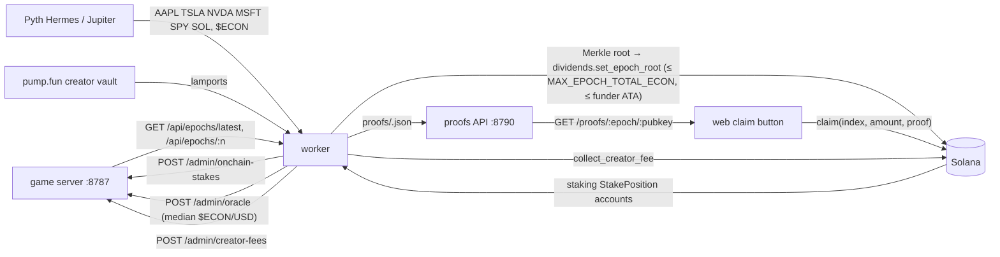

# @econ-sim/integration — settlement worker

Bridges the off-chain Economy Sim economy (authoritative tick server, `packages/server`)
to Solana. One long-running Node process, no build step:

```
npm --workspace=@econ-sim/integration run worker     # DRY_RUN=1 by default
npm --workspace=@econ-sim/integration test           # NET=1 adds live Pyth/Jupiter checks (+ PUMP_TEST_MINT=<pump.fun mint> for the creator-vault simulation)
```

## Flow



Every `POLL_MS` (30 s) the worker runs four independent steps; each failure is
logged once and retried on the next poll, so the worker starts fine with no game
server, no RPC and no chain build (it just keeps retrying).

The worker is the last line of defence between the game's soft economy and real
tokens: it never trusts a server-supplied total beyond a fixed ceiling, it tells
the server which $ECON is *actually* locked on-chain, and it publishes a
manipulation-resistant $ECON price.

### 1. Epoch settlement (`src/settle.ts`, `src/dividends.ts`)

* Pull every epoch closed since `DATA_DIR/settled.json.lastEpoch`.
* Keep allocations that carry a `claimant` pubkey, sum per claimant, sort by
  pubkey; `index` = position in that list. Amounts are $ECON minor units.
* Build the Merkle tree (`src/settlement.ts`) exactly as the on-chain program
  verifies it:

  ```
  leaf = keccak256(epoch u64le ‖ index u64le ‖ claimant 32B ‖ amount u64le)
  node = keccak256(min(a,b) ‖ max(a,b))          // sorted pair
  ```

  `epoch` in the leaf is the **on-chain** epoch: the program insists on
  `epoch == distributor.epoch + 1`, so game epochs without any claimant are
  recorded as skipped and the chain counter stays dense (`chainEpoch` in the
  proofs file).
* Write `DATA_DIR/proofs/<gameEpoch>.json`:

  ```json
  { "epoch": 12, "chainEpoch": 3, "tickClosed": 288, "root": "<hex>", "total": "1750100",
    "mint": "...", "programId": "...", "distributor": "...", "epochRoot": "...",
    "claims": { "<pubkey>": { "index": 0, "amount": "1500100", "proof": ["<hex>", "..."] } } }
  ```
* Before publishing, the epoch total is checked against **two ceilings**:
  `MAX_EPOCH_TOTAL_ECON` (whole $ECON, default 50 000, converted with the mint's
  decimals) and — when `DRY_RUN=0` — the authority's ATA balance. A total above
  either is **refused**: nothing is sent, no proofs file is written, and
  `settled.json` records `{ "blocked": "ceiling" | "funds", "total", "limit", "at" }`
  for that epoch *without* advancing `lastEpoch`. Later epochs wait behind it
  (the chain counter must stay dense); every poll retries, so raising the env
  var / topping up the ATA unblocks it. Blocked epochs are listed in
  `GET /health` and logged once per distinct reason. In DRY_RUN the balance check
  is skipped (the key is usually ephemeral) — the simulation reports funding
  errors instead.
* `init_distributor(claim_window_secs)` once (idempotent PDA check), then
  `set_epoch_root(epoch, root, total)` through `@coral-xyz/anchor` using
  `packages/chain/target/idl/dividends.json`. `total` $ECON is pulled from the
  authority's ATA into the vault, so the authority must hold the payout.
* `DRY_RUN=1`: the transaction is built, signed and **simulated**, the root is
  printed, nothing is sent; the epoch is still recorded so it is not re-processed.

### 2. On-chain stake observer (`src/stakes.ts`)

In-sim $ECON (airdrops, sim staking, sim yield) is *soft* and must never earn a
share of real creator-fee yield, otherwise every free wallet dilutes the pool.
Each poll the worker lists every `StakePosition` of the `staking` program's
$ECON pool (`getProgramAccounts` on `programs.json.staking` filtered by the
Anchor discriminator and `pool = PDA["pool", ECON_MINT]`, decoded with
`packages/chain/target/idl/staking.json`), sums `amount` per `owner`, drops
emptied positions, and posts

```
POST /admin/onchain-stakes { stakes: { "<owner pubkey>": amountEconMinor, … }, asOfSlot }
```

The server allocates on-chain **yield** rows pro-rata to this table, never to the
sim's `stakedEcon`. An empty table is posted too (it means nobody is staked).
The wallet is never asked to sign; this step is read-only.

### 3. RWA + $ECON oracle (`src/rwa.ts`, `src/median.ts`)

Pyth Hermes `GET /v2/updates/price/latest?ids[]=…&parsed=true` for the sim's
tickers `AAPL TSLA NVDA MSFT SPY` plus `SOL/USD`. Hermes now requires
`Authorization: Bearer $PYTH_API_KEY` (401 otherwise). Feed ids were taken from
https://pyth.network/developers/price-feed-ids and are re-verified by the test
suite against the keyless metadata endpoint `GET /v2/price_feeds?query=…`.

Without a key (or on 401) the worker falls back to Jupiter Price v3
(`https://lite-api.jup.ag/price/v3`; v2/v6 are dead) for Backed's xStocks — mints
verified on https://xstocks.com/products — using the `stockData.price` (underlying
equity price) field; SOL uses wrapped SOL. Quotes go to
`POST /admin/oracle { quotes: { AAPL: usd, … }, econUsd? }`.

`econUsd` (when `PUMP_MINT` is set) is **not** the Jupiter spot read. $ECON is a
thin memecoin and the CR→$ECON peg divides by this price, so a momentary dump
right before an epoch closes would inflate every allocation. The worker keeps the
last 12 polls (6 min at the default `POLL_MS`) and posts their **median**: a
manipulated price only moves the published value once it has been held for more
than half the window. The game server applies a second, independent layer — the
median of its last 24 oracle updates and a ±30 % clamp on the per-epoch change —
so both processes have to be fooled for a full window. The same median feeds the
creator-fee conversion below.

### 4. pump.fun creator fees (`src/pumpfun.ts`)

Real program `6EF8rrecthR5Dkzon8Nwu78hRvfCKubJ14M5uBEwF6P`; IDL vendored verbatim
from https://github.com/pump-fun/pump-public-docs (`idl/pump.json`) into
`src/idl/pump.json`. The creator is read from the coin's bonding curve
(`["bonding-curve", PUMP_MINT]` → `creator`), overridable with `PUMP_CREATOR`, and
defaults to the authority. Fees accrue in `["creator-vault", creator]`.

Each poll the worker reads the vault lamports and, when the increase since the
previous poll is positive, reports

```
econMinorPerTick = (Δlamports / 1e9) × SOL/USD ÷ $ECON/USD × 10^decimals ÷ ticksElapsed
```

(SOL/USD from Pyth or the Jupiter fallback, $ECON/USD = the median above when
`PUMP_MINT` is set, else the Jupiter spot for `ECON_MINT`; `ticksElapsed` from `GET /api/health`) via
`POST /admin/creator-fees { econMinorPerTick }`. When the claimable balance
(vault − the 650,240-lamport reserve the program keeps) exceeds
`MIN_SWEEP_LAMPORTS` it sends `collect_creator_fee_v2` — the current form of
`collect_creator_fee` per pump-public-docs — with the SOL-paired layout:
`creator, creator_token_account (wSOL ATA), creator_vault, creator_vault_token_account,
quote_mint = wSOL, token_program, associated_token_program, system_program,
event_authority, program`. The creator does not sign; the authority pays the fee
and the SOL lands in the creator account. In DRY_RUN the sweep is simulated only.

## Proofs API (`PORT`, default 8790)

| Route | Response |
|---|---|
| `GET /health` | `{ ok, lastEpoch, dryRun, rpc, server, maxEpochTotalEcon, blocked[], econUsd, errors }` — `blocked` lists refused epochs `{ epoch, blocked, total, limit, at }` |
| `GET /proofs/:epoch` | full proofs file (`:epoch` may be `latest`) |
| `GET /proofs/:epoch/:pubkey` | `{ epoch, chainEpoch, root, mint, programId, distributor, epochRoot, claimant, index, amount, proof[] }` — 404 when the wallet has no allocation |

CORS is `*` (GET only).

## How a player claims

1. Web calls `GET http://localhost:8790/proofs/latest/<wallet>` (or a specific
   epoch) and receives `chainEpoch`, `index`, `amount`, `proof` (hex[]) plus the
   `programId`, `distributor` and `epochRoot` addresses.
2. Web builds `dividends.claim(index: u64, amount: u64, proof: [u8;32][])` with:
   * `claimant` – wallet (signer, mut)
   * `distributor` – PDA `["distributor", mint]`
   * `epoch_root` – PDA `["epoch", distributor, chainEpoch u64le]` (the epoch is read
     from this account, not passed as an arg)
   * `receipt` – PDA `["receipt", epoch_root, claimant]` (init; a second claim fails)
   * `vault` – PDA `["vault", distributor]`
   * `claimant_ata` – wallet's ATA for the $ECON mint (create it in the same tx if missing)
   * `token_program`, `system_program`
3. The program recomputes the leaf from `(epoch_root.epoch, index, claimant, amount)`,
   folds the proof with sorted-pair keccak and transfers `amount` from the vault.
   Unclaimed funds are swept by the admin with `close_epoch` after the claim window.

## Environment

| Var | Default | Meaning |
|---|---|---|
| `RPC_URL` | `https://api.devnet.solana.com` | Solana RPC |
| `KEYPAIR` | `~/.config/solana/id.json` | authority: dividends admin, fee payer, funder ATA owner (DRY_RUN: ephemeral key if missing) |
| `SERVER_URL` | `http://localhost:8787` | game server |
| `ADMIN_TOKEN` | – | Bearer for `/admin/*` |
| `ECON_MINT` | wSOL in DRY_RUN, required live | $ECON SPL mint used by the distributor |
| `PUMP_MINT` | – | the pump.fun-launched $ECON mint (enables creator resolution + $ECON/USD) |
| `PUMP_CREATOR` | bonding-curve creator / authority | override the creator whose vault is swept |
| `DRY_RUN` | `1` | `0` sends transactions |
| `DATA_DIR` | `packages/integration/data` | `settled.json`, `proofs/` |
| `PORT` | `8790` | proofs API |
| `POLL_MS` | `30000` | loop interval |
| `MIN_SWEEP_LAMPORTS` | `50000000` | sweep threshold (0.05 SOL) |
| `MAX_EPOCH_TOTAL_ECON` | `50000` | whole $ECON; larger epoch totals are refused (`blocked: "ceiling"`) |
| `CLAIM_WINDOW_SECS` | `604800` | passed to `init_distributor` |
| `PYTH_HERMES_URL` | `https://hermes.pyth.network` | |
| `PYTH_API_KEY` | – | enables the Pyth path |
| `JUP_PRICE_URL` | `https://lite-api.jup.ag/price/v3` | |

Program ids are read from `packages/chain/programs.json`; every pubkey is validated
with `new PublicKey()` at startup and the worker exits with the offending key on
error. A `packages/integration/.env` file is read as a fallback for any of the above.

## Localnet end-to-end

Proves the whole path on a throwaway ledger: staked $ECON → epoch close →
Merkle root → `set_epoch_root` → proof → `claim` (from Node and from the web
Chain tab). Solana/Anchor live in WSL (`Ubuntu-24.04`); everything else runs on
the host. Scripts live in `scripts/` and share `packages/integration/.env.localnet`
(written by the bootstrap, git-ignored); every script is re-run safe.

1. **Validator** (WSL, ledger kept in the `~/econ-sim-chain` mirror so it stays off
   `/mnt/c` and out of git). Agave ≥ 4 activates SIMD-0500 in genesis, which
   rejects the SBPF v0 binaries anchor 0.31 builds (`Detected sbpf_version required
   by the executable which are not enabled`), so deactivate it:

   ```
   wsl -d Ubuntu-24.04 -- bash -lc 'cd ~/econ-sim-chain/packages/chain && solana-test-validator --reset --ledger test-ledger --quiet \
     --deactivate-feature B8JJXCy5amZyWG9r7EnUYLwzXSXTxG7GZ1qZ1qggo83g'
   ```

   WSL2 forwards the port, so the host reaches it at `http://127.0.0.1:8899`. If
   8899 is busy add `--rpc-port 8999 --faucet-port 9901 --gossip-port 1124
   --dynamic-port-range 1125-1225` and use `http://127.0.0.1:8999` everywhere below.
2. **Deploy** the four programs (ids must equal `programs.json`; the mirror's
   `target/deploy/*-keypair.json` are the checked-in ones):

   ```
   npm --workspace=@econ-sim/chain run deploy:localnet          # LOCALNET_RPC=http://127.0.0.1:8999 to override
   ```

   (On Windows export `WSLENV=LOCALNET_RPC` so the variable crosses into WSL.)
3. **Bootstrap** the accounts — $ECON mint (6 decimals, deployer = mint authority,
   1 000 000 $ECON minted to the deployer ATA), `init_distributor`, staking
   `init_pool`, memecoin `init_factory`, equity `init_config` — and write
   `.env.localnet` (`RPC_URL KEYPAIR ECON_MINT SERVER_URL ADMIN_TOKEN DRY_RUN=0
   MAX_EPOCH_TOTAL_ECON PORT CLAIM_WINDOW_SECS`):

   ```
   cd packages/integration
   RPC_URL=http://127.0.0.1:8899 KEYPAIR=//wsl.localhost/Ubuntu-24.04/root/.config/solana/id.json node scripts/bootstrap-localnet.ts
   ```

   `KEYPAIR` is the deployer; without it the script takes `~/.config/solana/id.json`
   and, on Windows, falls back to the WSL copy. `ECON_MINT` (env or a previous
   `.env.localnet`) is reused; existing PDAs are skipped.
4. **Test player**: generate `.localnet/player.json`, airdrop 2 SOL, mint it
   5 000 $ECON and lock 1 000 $ECON for 30 days (`FUND_ECON`, `STAKE_ECON`,
   `LOCK_DAYS` override):

   ```
   node scripts/stake-localnet.ts
   ```
5. **Tick server** (host, repo root; 8787/8788 may be taken):

   ```
   PORT=8793 TICK_MS=500 ALLOW_GUEST=1 ADMIN_TOKEN=e2e DATA_DIR=./data-e2e DOMAIN=localhost node packages/server/src/index.ts
   ```
6. **Sign the player in** (SIWS: nonce → ed25519-signed text → `POST /auth/siws`
   → `GET /api/me`) and switch the server to the external creator-fee feed
   (`POST /admin/creator-fees`, 2 $ECON/tick). Without the feed every pool is 0
   and no epoch carries a claimant:

   ```
   FEE_ECON_PER_TICK=2 node scripts/login-localnet.ts
   ```
7. **Worker**, live (`--env-file` because `loadConfig` only falls back to `.env`):

   ```
   POLL_MS=5000 DATA_DIR=./data-localnet node --env-file=.env.localnet src/index.ts
   ```

   Within one poll it logs `[stakes] 1 stakers / 1 positions, total=1000000000 minor`,
   and at the next epoch close (24 ticks = 12 s at `TICK_MS=500`) the player's `yield`
   row (2 $ECON × 24 ticks × 0.5 = 24 $ECON) becomes
   `[settle] epoch=N chainEpoch=1 holders=1 total=24000000 root=…` followed by
   `[dividends] set_epoch_root(epoch=1, total=24000000) confirmed <sig>`.
   `GET http://localhost:8790/proofs/N/<player pubkey>` then returns the proof
   (`proof: []` with a single claimant).
8. **Claim from Node** — same accounts as the web (`src/pdas.ts` is shared with
   `packages/web/lib/client/claim.ts`), asserts the ATA grows by exactly `amount`
   and that a second claim is rejected by the receipt PDA (`already in use`):

   ```
   node scripts/claim-localnet.ts N        # or `latest`
   ```
9. **Claim from the browser**: run the web app against the same stack and sign in
   with a wallet holding the player key (`.localnet/player.json`), open the Chain
   tab: one row per settled epoch (last 10), `Claim` sends the transaction, the
   toast + explorer link (`?cluster=custom&customUrl=…`) appear and the row flips
   to `claimed` (receipt lookup):

   ```
   cd packages/web && NEXT_PUBLIC_ECON_SERVER=http://localhost:8793 NEXT_PUBLIC_PROOFS_URL=http://localhost:8790 \
     NEXT_PUBLIC_RPC=http://127.0.0.1:8899 NEXT_PUBLIC_ECON_MINT=<ECON_MINT from .env.localnet> npx next dev -p 3000
   ```

   The wallet-standard adapter maps a `localhost`/`127.0.0.1` RPC to the
   `solana:localnet` chain, so the wallet has to list that chain.

Tear-down: stop the worker, server and web, `rm -rf data-e2e packages/integration/data-localnet`,
kill the validator (`pkill -f solana-test-validator` in WSL). `.env.localnet`,
`.localnet/` and the ledger are git-ignored.
